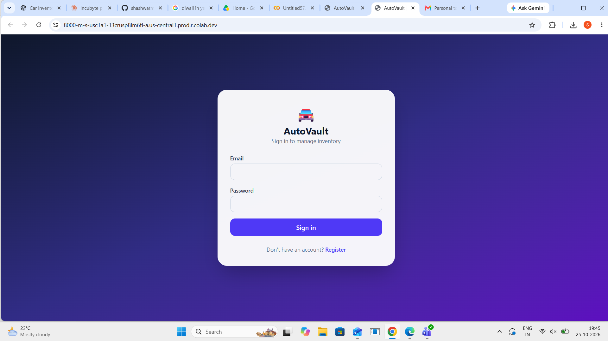
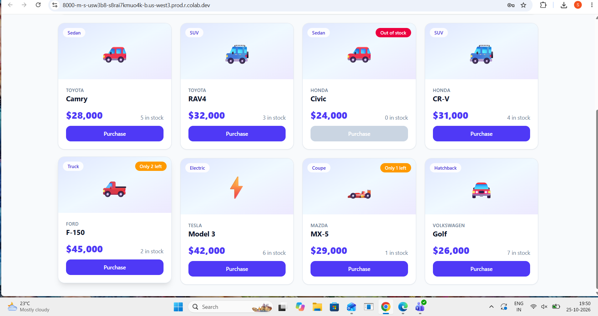
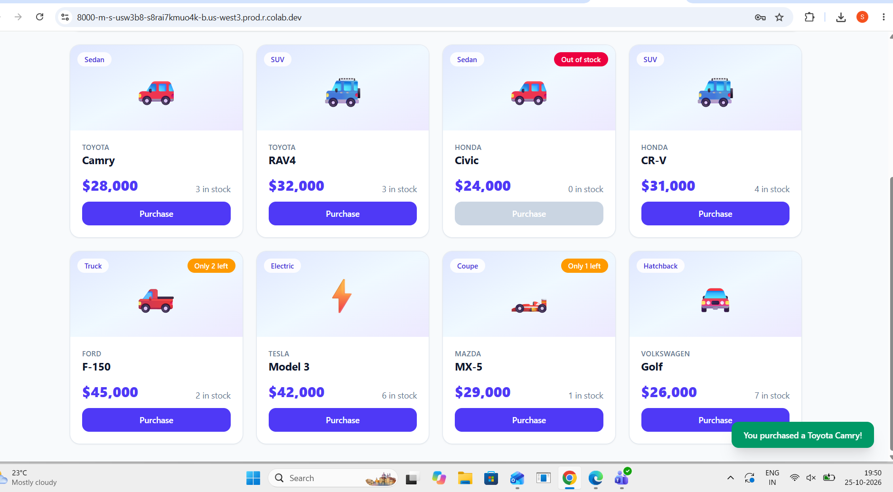
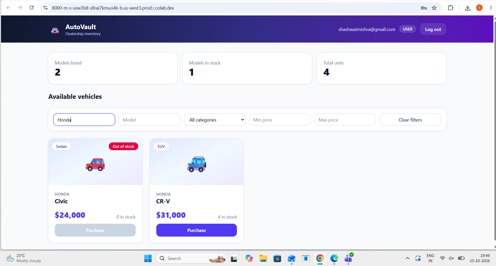

# 🚘 AutoVault: Car Dealership Inventory System

A full-stack inventory app for a car dealership. Users register and log in (JWT), browse and search vehicles,
and purchase them. Admins can also add, edit and delete vehicles and restock inventory.

Built test-first: the git history shows the Red → Green → Refactor rhythm (see `git log`).

**Live demo:** _add your deployed link here (optional)_

## Tech stack

| Layer | Tech |
|---|---|
| Backend | Python, FastAPI, SQLAlchemy 2, SQLite (file database), PyJWT, bcrypt |
| Frontend | React (Vite), Tailwind CSS, HTML5/CSS3 |
| Testing | pytest + pytest-cov + httpx (backend), Vitest + React Testing Library (frontend) |

## Architecture

~~~
backend/app/
  routers/        HTTP layer only (auth, vehicles, search, inventory)
  services/       business rules (AuthService, VehicleService, InventoryService)
  repositories/   database access (UserRepository, VehicleRepository)
  deps.py         authentication / admin authorization dependencies
  security.py     password hashing + JWT helpers
  errors.py       domain errors mapped to HTTP status codes
frontend/src/     React SPA (api client, auth form, dashboard, search, vehicle cards, admin form)
~~~

Design decisions:

* **SOLID layering:** routers → services → repositories; each class has one job and receives its dependencies.
* **Atomic purchases:** stock is decremented with a conditional `UPDATE ... WHERE quantity >= n`, so two buyers can never take the last car.
* **Access rules (per the spec):** any signed-in user can add/update/search/purchase; **delete** and **restock** are admin-only. The UI shows add/edit/delete/restock controls to admins only.
* New users always get the `USER` role; admins come from the seed script.

## API

| Method | Endpoint | Access |
|---|---|---|
| POST | `/api/auth/register` | public |
| POST | `/api/auth/login` | public |
| POST | `/api/vehicles` | authenticated |
| GET | `/api/vehicles` | authenticated |
| GET | `/api/vehicles/search?make=&model=&category=&min_price=&max_price=` | authenticated |
| PUT | `/api/vehicles/{id}` | authenticated |
| DELETE | `/api/vehicles/{id}` | **admin** |
| POST | `/api/vehicles/{id}/purchase` (optional body `{"quantity": n}`) | authenticated |
| POST | `/api/vehicles/{id}/restock` (body `{"amount": n}`) | **admin** |

Interactive docs: `http://localhost:8000/docs`

## Run locally

Prerequisites: Python 3.10+ and Node.js 20+.

**Backend**

~~~bash
cd backend
python -m venv .venv && source .venv/bin/activate
pip install -r requirements.txt
python seed.py                          # creates admin@example.com / Admin@12345 + sample cars
uvicorn app.main:app --reload --port 8000
~~~

**Frontend** (new terminal)

~~~bash
cd frontend
npm install
npm run dev                             # http://localhost:5173 (proxies /api to :8000)
~~~

Single-server mode: run `npm run build` in `frontend/`, then start the backend. FastAPI serves the built app at `http://localhost:8000`.

## Run the tests

~~~bash
cd backend && pytest --cov=app --cov-report=term-missing
cd frontend && npm test
~~~

## Screenshots

| | |
|---|---|
|  |  |
|  |  |

## My AI Usage

**Tools used:** Claude (Anthropic) in the claude.ai chat.

**How I used it:**
- **Planning:** Asked Claude for a stack suggestion and the TDD order (which tests to write first).
- **Boilerplate:** Claude generated the project structure, config files, the layered backend (routers, services, repositories) and the first version of the React components.
- **Tests:** Claude drafted test cases and edge cases (validation, 401/403/404/409, last-unit purchase, search combinations).
- **Debugging:** Fixed a missing `@testing-library/dom` peer dependency, and corrected the import path and test isolation in my own first test draft.
- **Commits:** Every AI-assisted commit has a `Co-authored-by: Claude <noreply@anthropic.com>` trailer. The refactor and screenshot commits were done without AI. Full raw chats are in `PROMPTS.md`.

**What I changed or wrote myself:**
- <<Change 1>>
- <<Change 2>>

**What I verified and understood:** I read through the JWT login flow, the admin-only dependency, and the atomic purchase (conditional UPDATE so stock can't go negative), and I can explain each.

**Reflection:** <<4-6 sentences in your own words>>

## Test report

### Backend (pytest + coverage)

~~~text
.........................................................                [100%]
================================ tests coverage ================================
_______________ coverage: platform linux, python 3.13.16-final-0 _______________

Name                                     Stmts   Miss  Cover   Missing
----------------------------------------------------------------------
app/__init__.py                              0      0   100%
app/config.py                                6      0   100%
app/database.py                             14      4    71%   24-28
app/deps.py                                 29      1    97%   33
app/errors.py                               21      0   100%
app/main.py                                 28      2    93%   19-20
app/models.py                               17      0   100%
app/repositories/__init__.py                 0      0   100%
app/repositories/user_repository.py         16      0   100%
app/repositories/vehicle_repository.py      46      0   100%
app/routers/__init__.py                      0      0   100%
app/routers/auth.py                         15      0   100%
app/routers/inventory.py                    17      0   100%
app/routers/search.py                        8      0   100%
app/routers/vehicles.py                     17      0   100%
app/schemas/__init__.py                      0      0   100%
app/schemas/auth.py                         15      0   100%
app/schemas/inventory.py                     5      0   100%
app/schemas/vehicle.py                      18      0   100%
app/security.py                             19      0   100%
app/services/__init__.py                     0      0   100%
app/services/auth_service.py                20      0   100%
app/services/inventory_service.py           16      0   100%
app/services/vehicle_service.py             25      0   100%
----------------------------------------------------------------------
TOTAL                                      352      7    98%
57 passed in 8.52s
~~~

### Frontend (Vitest)

~~~text
RUN  v5.0.5 /content/car-dealership/frontend

 ✓ src/components/VehicleCard.test.jsx (4 tests) 372ms

 Test Files  1 passed (1)
      Tests  4 passed (4)
   Start at  14:41:07
   Duration  1.98s (environment 59%, tests 21%, setup 11%, import 7%, transform 1%)
~~~
